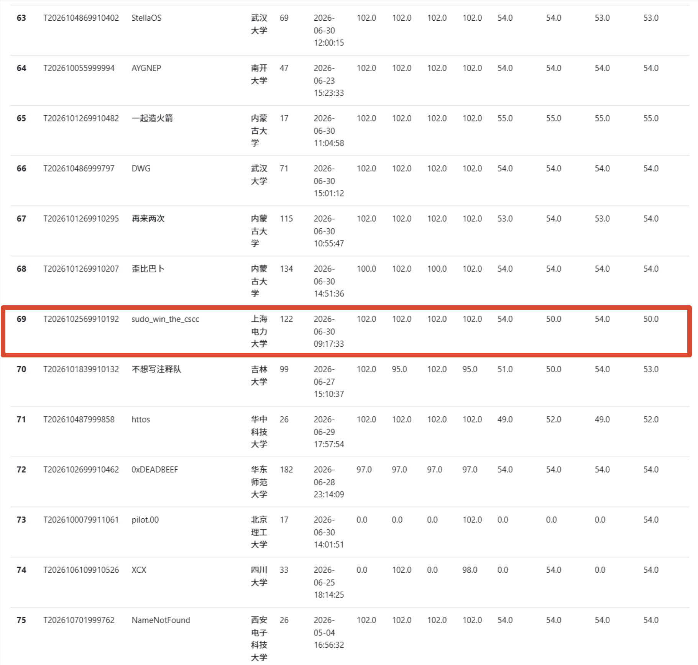
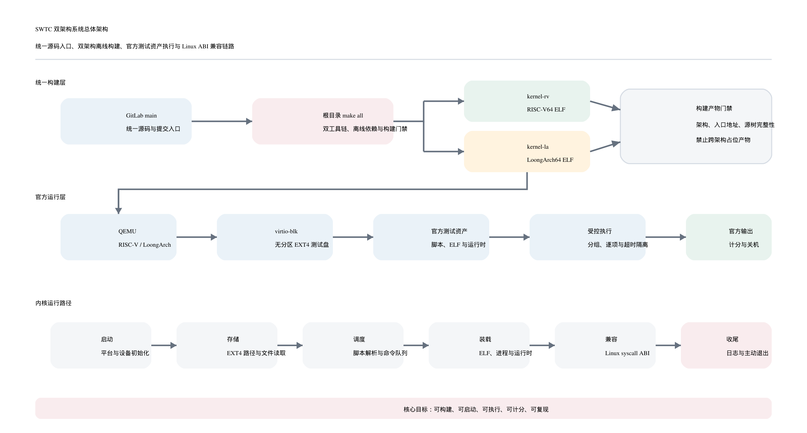

<p align="center">
  
</p>

# SWTC：面向官方评测的双架构 OS Kernel

SWTC 是面向 2026 操作系统大赛初赛评测开发的双架构内核项目，目标是在同一个提交中同时产出官方要求的 `kernel-rv` 与 `kernel-la`，并尽量稳定通过官方镜像中的 Linux ABI、文件系统、进程管理与基础应用测试。

项目当前由两条主线组成：

- **RISC-V64 主线**：位于 `SWTC/`，以 Titanix 往届 GPLv3 开源架构为基础，重点完成官方镜像入口、Linux ABI、EXT4 读取、脚本解析和测试组执行适配。
- **LoongArch64 主线**：位于 `SWTC-la/`，参考 StarryX 与 ArceOS 组件化内核，重点完成官方 LoongArch 工具链、真实 `kernel-la`、EXT4 测试盘、BusyBox/basic 等测试入口适配。

> 状态说明：当前最高且最新可见官方成绩为 `1009.8903911255481`（提交时间 2026-06-30 09:17:33，Accepted）。其中 basic 为 408、BusyBox 为 208、Lua 为 36、libcbench 为 86.84477333493804、musl-rv libctest 为 217、musl-rv LTP 为 314。

## 作品基本信息

| 项目 | 内容 |
|---|---|
| 队伍名称 | `sudo_win_the_cscc` |
| 操作系统名称 | SWTC |
| 参赛学校 | 上海电力大学 |
| 比赛阶段 | 2026 操作系统大赛初赛开发期 |
| 支持架构 | RISC-V64、LoongArch64 |
| 主要语言 | Rust、Makefile、少量汇编/Shell |
| 官方产物 | `kernel-rv`、`kernel-la` |
| 构建方式 | 根目录 `make all`，离线 vendor 构建 |
| 详细初赛文档 | [docs/preliminary-report.md](docs/preliminary-report.md) |
| 初赛文档（PDF） | [SWTC-初赛文档.pdf](SWTC-初赛文档.pdf) |
| 开发进度 | [docs/progress.md](docs/progress.md) |

## 项目人员

| 参赛身份 | 姓名 | 学校与专业 |
|---|---|---|
| 指导教师 | 徐曼 | 上海电力大学 |
| 队长、队员 | 余子豪 | 上海电力大学，计算机科学与技术（卓越计划），2024-09 入学 |
| 队员 | 王溢敏 | 上海电力大学，计算机科学与技术（卓越计划），2024-09 入学 |

## 官网评测记录



> 2026-06-30 官网评测列表截图，红框为本队 `sudo_win_the_cscc`；参赛操作系统名称为 SWTC。

## 系统架构



## 完成度概览

| 模块 | 当前完成度 | 说明 |
|---|---|---|
| 根构建 | 已接入 | `make all` 生成 `kernel-rv` 和真实 `kernel-la`；默认拒绝用 RISC-V ELF 冒充 LoongArch ELF |
| 离线依赖 | 已接入 | RV/LA vendor 均可离线构建；对官方过滤隐藏文件的行为做了 checksum 恢复与非隐藏路径迁移 |
| RISC-V basic | 已线上得分 | glibc/musl basic 长期稳定，是保分基础 |
| RISC-V BusyBox/Lua/libcbench | 已线上得分 | 已接入官方脚本、资源暂存和串行执行 |
| RISC-V libctest/LTP | 部分完成 | musl libctest 已拿满 217；LTP 已扩展到稳定子集，仍需继续按 case 推进 |
| LoongArch basic/BusyBox | 本地通过并曾线上进分 | 本地 basic 64/64、BusyBox 55/55；当前重点是恢复线上真实 LA 构建和防止 LA 全列为 0 |
| LoongArch libcbench/libctest/LTP | 部分接入 | 已有脚本入口和隔离策略，仍需继续用官方结果反推 ABI 缺口 |
| 文件系统 | 可支撑官方入口 | 支持从官方 EXT4 测试盘读取脚本、ELF、资源文件，并提供 tmpfs staging |
| 进程与 syscall | 最小 Linux ABI | 覆盖 `openat/read/write/fstat/execve/wait4/clone/brk/mmap/futex/time` 等测试常用路径 |

## 主要工作内容

- **官方评测入口适配**：根目录保留 `Makefile/GNUmakefile`，统一生成官方要求的两个 ELF；启动后自动识别官方 EXT4 测试盘、固定路径测试脚本和 glibc/musl 目录布局。
- **测试脚本自动解析**：解析 basic、BusyBox、Lua、libcbench、libctest、LTP 等测试脚本，按官方日志格式输出测试组 START/END，保证 QEMU 能主动关机退出。
- **Linux ABI 兼容推进**：围绕官方 ELF 的真实运行日志补齐进程、文件描述符、内存映射、时间、信号、futex 和常见 libc 探针路径。
- **LoongArch 真实构建**：接入官方 LoongArch nightly、musl GCC、ArceOS/StarryX 组件与离线 vendor，构建真实 LoongArch ELF，避免无效占位文件浪费评测队列。
- **官方源包过滤兼容**：针对官方提交会过滤隐藏路径、偶发遗漏 vendor 子目录的问题，将关键依赖迁移到非隐藏路径，并在根构建中加入源树完整性检查。

## 创新点与工程特点

- **双架构同仓交付**：同一个根构建同时产出 RISC-V 与 LoongArch 官方 ELF，并隔离两套 Rust 工具链、vendor 和目标平台配置。
- **评测日志驱动开发**：不盲目堆功能，而是以官网结果和本地官方镜像日志反推缺失 ABI，优先保证可得分测试组稳定。
- **脚本到命令队列的适配层**：将官方 shell 脚本转换为内核可控的测试命令队列，减少对完整用户态 shell/runtime 的依赖。
- **防无效提交门禁**：根构建检查 LoongArch 关键源树和工具链，默认拒绝生成无效 `kernel-la` placeholder。
- **可复现离线构建**：保留非隐藏 `cargo-checksum.json`，构建时恢复 Cargo 需要的隐藏 checksum，适配官方源包过滤约束。

## 构建与运行

优先在 WSL/bash 中运行：

```bash
cd /mnt/d/os-kernel-contest
make all
```

官方风格 RISC-V 无盘启动：

```bash
qemu-system-riscv64 -machine virt -kernel kernel-rv -m 1G -nographic \
  -smp 1 -bios default -no-reboot \
  -device virtio-net-device,netdev=net -netdev user,id=net -rtc base=utc
```

官方风格 RISC-V EXT4 测试盘启动：

```bash
qemu-system-riscv64 -machine virt -kernel kernel-rv -m 1G -nographic \
  -smp 1 -bios default \
  -drive file=/path/to/test.img,if=none,format=raw,id=x0 \
  -device virtio-blk-device,drive=x0,bus=virtio-mmio-bus.0 -no-reboot \
  -device virtio-net-device,netdev=net -netdev user,id=net -rtc base=utc
```

LoongArch 构建需要官方镜像同源环境中的 `cmake`、`loongarch64-linux-musl-gcc`、`libclang` 和 `nightly-2025-05-20`。架构状态与验证方法见 [初赛文档](docs/preliminary-report.md)。

## 目录结构

```text
.
├── .gitattributes               # 文本、二进制文件与平台换行属性
├── .gitignore                   # 忽略构建产物、镜像、隐藏 Cargo 文件与本地配置
├── Makefile                     # 官方根构建入口，执行 make all
├── GNUmakefile                  # 官方根构建入口兼容文件
├── README.md                    # 项目总览、成绩、构建方式与文档导航
├── SWTC/                        # RISC-V64 主线内核
│   ├── Makefile                 # RISC-V 子构建入口
│   ├── rust-toolchain.toml      # RISC-V 固定 Rust nightly
│   ├── bootloader/              # RISC-V 启动与加载相关代码
│   ├── dependencies/            # RISC-V 本地依赖源码
│   ├── kernel/                  # RISC-V 内核、驱动、VFS、syscall 与 oscomp 适配
│   ├── user/                    # RISC-V 内置用户程序与 runtestcase
│   └── vendor/                  # RISC-V 离线 Cargo 依赖
├── SWTC-la/                     # LoongArch64 主线内核
│   ├── Cargo.toml               # LoongArch workspace 配置
│   ├── Cargo.lock               # LoongArch 依赖锁定文件
│   ├── Makefile                 # LoongArch 子构建入口
│   ├── README.md                # LoongArch 子项目说明
│   ├── rust-toolchain.toml      # LoongArch 固定 Rust nightly
│   ├── LICENSE.*                # 上游组件许可证
│   ├── arceos/                  # ArceOS 组件化内核基础
│   ├── cargo-config/            # 非隐藏 Cargo 配置模板
│   ├── dependencies/            # LoongArch 本地依赖与官方过滤兼容副本
│   ├── scripts/                 # LoongArch 构建、运行和辅助脚本
│   ├── src/                     # LoongArch 启动入口、init 与测试调度逻辑
│   ├── vendor/                  # LoongArch 离线 Cargo 依赖
│   ├── xapi/                    # StarryX API 层源码
│   ├── xcore/                   # StarryX 核心运行时
│   └── xmodules/                # StarryX 模块集合
├── docs/                        # 初赛文档、开发进度与图片资源
│   ├── assets/                  # README 与初赛文档使用的截图、Logo、架构图
│   ├── preliminary-report.md    # 初赛作品说明文档
│   └── progress.md              # 开发进度、线上结果与回归记录
├── output/
│   └── pdf/
│       └── SWTC-preliminary-report.pdf
└── tools/
    └── generate_preliminary_pdf.py
```

## 文档导航

- [初赛文档](docs/preliminary-report.md)：面向评审的作品说明、架构、完成度和创新点。
- [开发进度](docs/progress.md)：按日期记录线上结果、回归原因、修复策略。

## 许可证与参考来源

RISC-V 主线参考 Titanix GPLv3 架构；LoongArch 主线参考 StarryX、ArceOS 与相关组件。各上游组件的许可证文件随对应源码目录保留。本队新增内容集中在官方评测入口、构建系统、ABI 兼容、双架构集成、日志驱动修复和离线构建适配。

参考项目仅用于设计与文档组织学习，不直接复制 Phoenix、StarryX、NoAxiom 等项目代码。参考仓库与使用边界列于[初赛文档](docs/preliminary-report.md#8-参考与致谢)。
