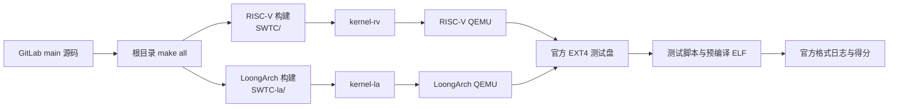
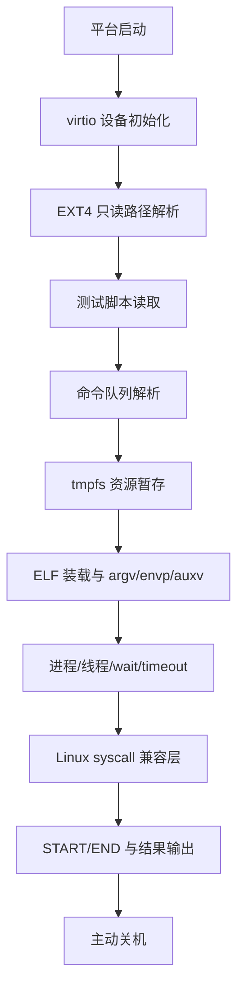

# SWTC 初赛文档

## 1. 作品概述

SWTC 是一个面向 2026 操作系统大赛官方评测的双架构内核项目。项目目标是在同一个仓库和同一次官方提交中，稳定生成并运行 RISC-V64 `kernel-rv` 与 LoongArch64 `kernel-la`，覆盖官方镜像中的 basic、BusyBox、Lua、libcbench、libctest、LTP 等测试组。

当前项目采用“两条主线、一个提交入口”的方式推进：RISC-V 主线负责保分和 Linux ABI 扩展，LoongArch 主线负责真实架构支持与新增得分点恢复。历史最高可见官方成绩为 `983.6805892892955`（2026-06-29 03:06:43）。最新可见官网提交为 2026-06-30 08:31:57，结果为 `Compile Error`，错误显示评测机未进入仓库根 `Makefile`；本地和 GitLab 远端已经确认根构建存在且干净导出 `make all` 通过。

## 2. 总体架构



内核运行时的核心路径如下：



## 3. 工作内容

### 3.1 官方构建入口

- 根目录保留 `Makefile` 与 `GNUmakefile`，评测机执行 `make all` 即可生成 `kernel-rv` 和 `kernel-la`。
- RISC-V 固定使用 `nightly-2025-02-01`，LoongArch 固定使用 `nightly-2025-05-20`，避免一个全局工具链污染两套架构。
- 构建流程恢复 Cargo 需要的隐藏 checksum，同时保留非隐藏 `cargo-checksum.json`，适配官方提交过滤隐藏文件的行为。
- 根构建加入 LoongArch 源树完整性检查，默认拒绝生成无效 `kernel-la` placeholder。

### 3.2 RISC-V 官方测试适配

- 从官方 virtio-blk 测试盘识别无分区 EXT4，并按 `glibc/`、`musl/`、根目录顺序定位测试脚本。
- 解析 basic、BusyBox、Lua、libcbench、libctest、LTP 等脚本，把命令转为内核控制的执行队列。
- 为每个测试组暂存 ELF、脚本资源和运行时文件，减少跨测试污染。
- 支持最小 Linux ABI：文件描述符、路径解析、`execve`、`wait4`、`clone/fork`、`brk/mmap`、时间 syscall、futex 等。

### 3.3 LoongArch 支持

- 接入 StarryX/ArceOS 风格的 LoongArch 组件化内核，修复启动栈、工具链和官方镜像启动路径。
- 完成 LoongArch 离线 vendor、`axconfig-gen` 离线安装和官方 GCC 13.2 musl 工具链适配。
- 本地验证真实 LoongArch ELF 入口为 `0x80000000`，basic 64/64 与 BusyBox 55/55 可运行并主动退出。
- 将 `xapi` 主构建路径迁移到非隐藏依赖目录，规避官方源包偶发遗漏 `SWTC-la/xapi` 的问题。

## 4. 完成度

| 测试/模块 | RISC-V 状态 | LoongArch 状态 | 备注 |
|---|---|---|---|
| 根构建 | 通过 | 通过 | 生成两个官方 ELF；干净导出 `make all` 已验证 |
| basic | 线上稳定得分 | 本地 64/64，曾线上进分 | 当前需排除官网源包/工作目录异常 |
| BusyBox | 线上得分 | 本地 55/55，曾线上进分 | LA 侧已做沙箱化，避免扫描 LTP 大树 panic |
| Lua | 线上得分 | 已接入，待恢复线上确认 | 依赖 busybox/lua 资源暂存 |
| libcbench | 线上得分 | 部分接入 | LA glibc libcbench 曾触发 trap，已隔离高风险项 |
| libctest | musl static/dynamic 线上 217 | 已接入，待继续验证 | RV 是当前重要得分来源 |
| LTP | 稳定子集线上得分 | 部分接入 | 继续按 case 小步推进 |
| lmbench/iozone | 暂停盲试 | 暂停盲试 | 两次 iozone 尝试导致回退，当前不作为初赛保分路径 |
| 文件系统 | EXT4 只读 + tmpfs staging | EXT4 只读 + staging | 足够支撑官方测试入口 |
| 进程模型 | 最小 Linux ABI | StarryX/ArceOS 适配 | 仍非完整 Linux 进程隔离模型 |

## 5. 创新点

- **双架构统一提交**：同一仓库同时维护 RISC-V 与 LoongArch 两套内核和工具链，根构建统一产出官方要求的两个 ELF。
- **官方脚本内核态调度**：不依赖完整 shell 环境，直接解析官方脚本并转为命令队列，由内核控制执行顺序、超时和日志格式。
- **评测系统约束适配**：针对官方过滤隐藏文件、源包子目录偶发缺失、长时间排队等约束，加入非隐藏依赖路径、完整性门禁和诊断输出。
- **日志反推 ABI**：以线上评测日志和本地官方镜像为依据，逐个补齐 syscall 与运行时语义，避免展示性功能优先于得分路径。
- **真实 LoongArch 防线**：默认不再把 RISC-V 产物复制成 `kernel-la`，构建失败即暴露问题，减少无效评测。

## 6. 构建与验证方式

```bash
cd /mnt/e/WorkSpace/MinOS/os-kernel-contest
make all
```

生成产物：

- `kernel-rv`：RISC-V executable ELF，入口 `0x80200000`。
- `kernel-la`：LoongArch executable ELF，入口 `0x80000000`。

常用验证包括：

- `git diff --check`：检查 Markdown/Makefile 空白问题。
- 干净导出源码后执行 `make all`：验证不依赖本地未提交文件。
- RISC-V 无盘 QEMU：验证无测试盘时可主动关机。
- 官方 EXT4 镜像 QEMU：验证测试组 START/END、case 输出和最终关机。
- 官方网页结果回读：更新 `docs/progress.md` 与 `docs/test-matrix.md`。

## 7. 当前问题与下一步

- 最新官网错误显示未进入仓库根 `Makefile`，需继续核对官网实际源包或提交方式；下一次日志应出现根构建诊断标记。
- 当前首要目标是恢复 `983.6805892892955` 高分基线，而不是继续大范围添加不稳定测试组。
- LoongArch 侧需要继续确认真实 `kernel-la` 在线上恢复 basic/BusyBox/Lua/libcbench 得分。
- LTP 和 libcbench 后续应按小批量、可回滚、可从日志解释的方式推进。

## 8. 参考与致谢

项目参考了往届优秀开源作品的设计、文档组织和工程推进方式，包括 Del0n1x、Chronix、NoAxiom、StarryX、NPUcore-IMPACT、UMI、Alien、Titanix、NPUcore、UltraOS 等。SWTC 保留 Titanix、StarryX、ArceOS 及相关组件的许可证和来源信息；本队增量主要集中在 2026 官方评测适配、双架构构建、ABI 修复和离线构建工程化。

以下仓库仅用于学习系统设计、测试推进路线与文档组织；除项目中已明确声明的 Titanix、StarryX/ArceOS 基础外，不直接复制其实现代码。

| 年份 | 作品/队伍 | 开源仓库 |
|---|---|---|
| 2025 | Del0n1x | [Ya0rk/myOS](https://github.com/Ya0rk/myOS) |
| 2025 | Chronix | [PACTHEMAN123/Chronix](https://github.com/PACTHEMAN123/Chronix) |
| 2025 | NoAxiom | [NoAxiom/NoAxiom-OS](https://github.com/NoAxiom/NoAxiom-OS) |
| 2025 | StarryX | [Anekoique/StarryX](https://github.com/Anekoique/StarryX) |
| 2024 | NPUcore-IMPACT!!! | [Fediory/NPUcore-IMPACT](https://github.com/Fediory/NPUcore-IMPACT) |
| 2024 | NPUcore-IMPACT!!! 官方归档 | [oscomp/first-prize-osk2024-npucore-impact](https://github.com/oscomp/first-prize-osk2024-npucore-impact) |
| 2023 | PLNTRY / UMI | [js2xxx/umi](https://github.com/js2xxx/umi) |
| 2023 | Alien | [Godones/Alien](https://github.com/Godones/Alien) |
| 2023 | Titanix | [greenhandzpx/Titanix](https://github.com/greenhandzpx/Titanix) |
| 2022 | NPUcore | [echodjx/NPUcore](https://github.com/echodjx/NPUcore)、[Baozixu99/oskernel2022-npucore](https://github.com/Baozixu99/oskernel2022-npucore) |
| 2021 | UltraOS | [xiyurain/UltraOS](https://github.com/xiyurain/UltraOS) |
